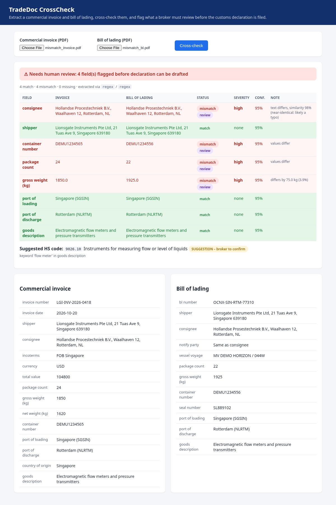

# TradeDoc CrossCheck

A small demo of the core loop behind AI customs-declaration drafting: **extract** fields from a
commercial invoice and a bill of lading, **cross-check** them, and **route discrepancies to a human**
before anything is filed.



> All sample documents in `samples/` are fictitious and generated by `samples/make_samples.py`.

## What it does
- `POST /extract` – upload a PDF, get structured JSON (Pydantic `CommercialInvoice` or `BillOfLading`),
  with per-field confidence and a **suggested** HS code.
- `POST /crosscheck` – upload an invoice and a B/L, get a field-by-field comparison:
  `match` / `mismatch` / `missing`, a severity, confidence, and a `needs_human_review` flag.
- `GET /` – single-page UI showing both documents side by side with mismatches highlighted.
- `GET /docs` – auto-generated OpenAPI docs.

## Architecture
```
PDF ──pdfplumber──> text ──┬─> xAI Grok (XAI_API_KEY)    ┐
                           └─> regex fallback (no key)   ┴─> Pydantic validation ─> doc + confidence
                                                                          │
                                                          HS suggester <──┘
invoice + B/L ──> crosscheck rules (per-field comparator + severity) ──> CrossCheckResult
```
| File | Role |
|---|---|
| `app/schemas.py` | Pydantic models for both doc types and the cross-check result |
| `app/extract.py` | Text extraction, xAI Grok extraction (OpenAI-compatible Chat Completions, JSON mode), deterministic regex fallback |
| `app/crosscheck.py` | Comparison rules: normalised text, exact IDs, weight tolerance (0.5%), typo hints |
| `app/hs.py` | Keyword HS suggester (illustrative table, always flagged as a suggestion) |
| `app/main.py` | FastAPI routes and the static UI |

The LLM output is validated against the same Pydantic schema as the regex path; if xAI fails or
returns invalid JSON, the regex extractor is used, so the app never hard-fails on AI.

## Human-in-the-loop design
- **The system flags; a person decides.** Nothing is auto-corrected or auto-filed.
- A field needs review if it is a mismatch, is missing on either side, **or** matched with extraction
  confidence below 0.80 – a confident-looking match from a shaky read is still a risk.
- Severity reflects customs impact: consignee, container number, package count and gross weight are
  `high` (they drive manifest matching and holds); ports and shipper `medium`; description `low`.
- Near-identical text (similarity > 90%) is labelled as a likely typo to speed up the reviewer.
- HS codes are returned with `is_suggestion: true` and the basis for the suggestion; a licensed broker confirms.

## Run
```bash
python -m venv .venv && source .venv/bin/activate
pip install -r requirements.txt
python samples/make_samples.py          # regenerate sample PDFs (optional)
uvicorn app.main:app --reload           # http://127.0.0.1:8000
pytest -q
```
### Using xAI (Grok)
Copy `.env.example` to `.env` (or export the variables) and set `XAI_API_KEY`. The app calls
`https://api.x.ai/v1/chat/completions` with `response_format: json_object`. PDFs are **not** uploaded:
the text pdfplumber extracts is sent, and the reply is validated against the Pydantic schema.
- `XAI_MODEL` – default `grok-4.3` (fast, low-cost; 1M context). `grok-4.7` also works for harder documents.
- `XAI_REASONING_EFFORT` – default `none` for low latency; set `low`/`medium`/`high`, or blank to omit.

With no key the regex fallback runs, so the demo and tests work offline. The UI shows which
extractor was used (`xai:grok-4.3` or `regex`).

Docker:
```bash
docker build -t tradedoc-crosscheck .
docker run -p 8000:8000 --env-file .env tradedoc-crosscheck
```

Try it: upload `samples/mismatch_invoice.pdf` + `samples/mismatch_bl.pdf` (4 planted discrepancies:
consignee spelling, transposed container digits, 24 vs 22 packages, 1,850 vs 1,925 kg) or the `clean_*` pair.

## Next steps (not built)
OCR for scanned docs, packing list as a third source, line-item reconciliation, ISO 6346 container
check-digit validation, a reviewer audit log, and mapping to a declaration format (e.g. TradeNet).
